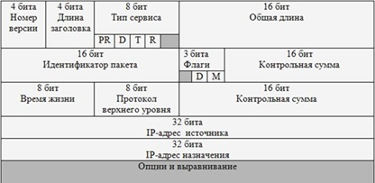
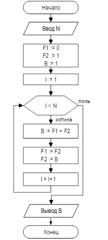

# Пробный тест олимпиады ИИКБ

Источник: [пробный тест на сайте олимпиады](https://ikb.mtuci.ru/olymp/mod/quiz/view.php?id=1). Ниже сохранены задания и разборы из доступного просмотра завершённой попытки. Иллюстрации сохранены рядом с этим файлом.

## 1. Смайлики и ASCII

**Условие.** Аналитику удалось обнаружить папку с графическими изображениями, в которой скрыто осмысленное кодовое слово. Помогите определить кодовое слово, если известно, что для его сокрытия содержимое файлов не менялось.


**Разбор.** Смайлики делятся на грустные и весёлые, поэтому каждому типу можно сопоставить бит. При соответствии «грустный = 0, весёлый = 1» получается последовательность `01110101 01110011 01100101 01110010`. Это ASCII-коды символов `user`.

**Ответ:** `user`.

## 2. Зеркальные простые числа

**Условие.** У Альберта в качестве пин-кода от банковской карты используется комбинация из двух двузначных простых чисел. Второе число является зеркальным отражением первого (например, 13 и 31). Сколько максимально попыток понадобится, чтобы гарантированно подобрать пин-код?

**Разбор.** Двузначные простые числа, зеркальное отражение которых тоже простое, дают девять комбинаций: `11 11`, `13 31`, `17 71`, `31 13`, `37 73`, `71 17`, `73 37`, `79 97`, `97 79`.

**Ответ:** `9`.

## 3. Скрытый канал в поле ID IPv4

**Условие.** Василий разработал сетевую программу, которая скрытно отправляет информацию с пользовательского компьютера на центральный сервер. Чтобы антивирус не обнаружил передачу, программа использует поле ID (идентификатор пакета) в заголовке IP-пакета размером 16 бит. Размер IP-пакета — 1500 байт, заголовка — 54 байта. Какой суммарный объём данных необходимо и достаточно отправить, чтобы передать сообщение «Встреча завтра вечером в 18:00 у памятника Пушкину.»? Ответ укажите в байтах.



**Разбор сайта.** Поле ID в IPv4 имеет размер 16 бит, то есть в один пакет помещается 2 байта сообщения. В разборе сайта длина сообщения указана как 51 байт, поэтому нужно `ceil(51 / 2) = 26` пакетов. В каждом пакете передаётся `1500 − 54 = 1446` байт пользовательских данных. Итого `1446 × 26 = 37 596` байт.

**Ответ по разбору сайта:** `37596` байт.

## 4. Число Фибоначчи по блок-схеме

**Условие.** На рисунке представлена блок-схема алгоритма работы программы. Что выведет программа, если на вход подать `11`?



**Разбор.** Алгоритм вычисляет числа Фибоначчи с нумерацией, начинающейся с 1. Одиннадцатое число последовательности равно 89.

**Ответ:** `89`.

## 5. Восстановление парольной фразы

**Условие.** Программа Юлии формирует парольную фразу из строки `cieoserrhlutncj `, используя параметры `key` и `step`. Требуется восстановить фразу из английских слов. В программе символы печатаются по индексам `i % size`; после каждого шага `i` увеличивается на `step`, а `step` — на единицу. При этом цикл продолжается, пока `i < key * step`.

```c
void get_password(void) {
    char s[100] = "cieoserrhlutncj ";
    int key;
    int step;
    int size = strlen(s);
    printf("Enter key number: ");
    scanf("%d", &key);
    printf("Enter step: ");
    scanf("%d", &step);
    for (int i = 0; i < key * step; i += step, step++)
        printf("%c", s[i % size]);
}
```

**Разбор.** Перебор допустимых значений параметров даёт английские слова при `key = 5, step = 3` (`cornelius`) и при `key = 8, step = 3` (`cornelius three`). Так как фраза должна состоять из нескольких слов, подходит второй вариант; параметры также соответствуют дате 8 марта.

**Ответ:** `cornelius three`.
