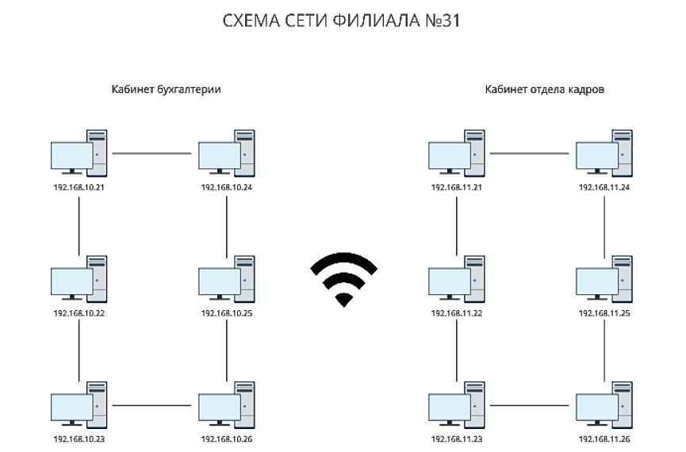

## Модуль 4. Раздел 2. Формат задач по форензике и сетевой стеганографии

---

### Полезные ссылки

- [Архив задач на сайте олимпиады](https://ikb.mtuci.ru/archive_task/)
- [Материалы за 2025–2026 учебный год](https://ikb.mtuci.ru/materials/2026/)
- [Материалы за 2024–2025 учебный год](https://ikb.mtuci.ru/materials/2025/)

---

> В обеих задачах разбирается первый вариант.

---

## №1. Задача «Ping» (заключительный этап 2025–2026 года, 11 класс, задача №4, вариант 1)

### Условие

> Аналитики компании «ИТ-Сеть» получили фрагмент сетевого журнала и схему сети. Известно, что в этом трафике передали место встречи двух сотрудников. Восстановите название места по записям журнала.
>
> 
>
> [Журнал трафика logs_v1.txt](../materials/pure-variants/2025-2026/zakl-11-class-materials/4/logs_v1.txt) · [Оригинал задачи, с. 10–13](../materials/pure-variants/2025-2026/zakl-11-class-materials/zakl-11-class.pdf#page=10)

### Решение

В журнале чередуются записи для бухгалтерии (`192.168.10.x`) и отдела кадров (`192.168.11.x`). В каждом блоке из шести записей запросы идут по одному маршруту. Последние числа в IP-адресах показывают, какие компьютеры участвуют в каждом запросе:

```text
.21 → .22 → .23 → .26 → .25 → .24 → .21
```

В строках с ответом есть поле `icmp_seq=`. Остальные строки блока сообщают об истечении времени ожидания. Отметим на схеме участки маршрута, где получен ответ. Во всём файле встречаются два рисунка.

| Какие запросы получили ответ | Рисунок на схеме | Бит |
| --- | --- | --- |
| Все шесть | Замкнутый прямоугольник | `0` |
| Только `.26 → .25` и `.25 → .24` | Правая вертикаль | `1` |

Первые восемь блоков в порядке файла дают `01100011`. В таблице ASCII это строчная `c`. Применим то же правило к остальным блокам и прочитаем каждый байт как символ ASCII.

### Полное решение на Python

Сохраните скрипт рядом с `logs_v1.txt` и запустите его из этой папки.

```python
from pathlib import Path

lines = Path("logs_v1.txt").read_text(encoding="utf-8").splitlines()
records = [line for line in lines[1:] if line.strip()]
block_size = 6
bit_by_pattern = {"111111": "0", "000110": "1"}

bits = []
for start in range(0, len(records), block_size):
    block = records[start:start + block_size]
    pattern = "".join("1" if "icmp_seq=" in row else "0" for row in block)
    bits.append(bit_by_pattern[pattern])

message_bits = "".join(bits)
byte_values = [
    int(message_bits[start:start + 8], 2)
    for start in range(0, len(message_bits), 8)
]
print(bytes(byte_values).decode("ascii"))
```

Из 432 записей получается 72 бита, то есть девять символов:

```text
01100011 01100001 01100110 01100101 00100000 01000101 01001110 01001111 01010100
```

**Ответ:** `cafe ENOT`.

---

## №2. Задача «Система защиты» (заключительный этап 2024–2025 года, 11 класс, задача №5, вариант 1)

### Условие

> Компания настраивает защиту от DDoS-атак для веб-сервера `172.17.148.17` и почтового сервера `172.17.148.18`. Для каждого сервера система считает, сколько разных IP-адресов обращались к нему в течение минуты, и выдаёт предупреждение, если это число превышает заданный порог.
>
> По журналу обычного трафика найдите максимальное число уникальных клиентов в минуту для каждого сервера. Установите пороги с запасом 20% относительно этих максимумов и обоснуйте ответ.

[Журнал запросов log_v1.log](../materials/pure-variants/2024-2025/zakl-11-class-materials/5/log_v1.log)
### Решение

В каждой строке записаны дата, время, IP-адрес источника и IP-адрес назначения. Объединяем записи с одинаковыми датой, часом, минутой и адресом назначения. Внутри каждой группы собираем источники во множество, чтобы повторные обращения с одного IP учитывались один раз.

Например, в 10:03 в журнале есть четыре запроса к веб-серверу. Два из них пришли с адреса `172.17.148.80`, поэтому в эту минуту у веб-сервера было три уникальных источника.

### Полное решение на Python

Сохраните скрипт рядом с `log_v1.log` и запустите его из этой папки.

```python
from collections import defaultdict
from math import ceil
from pathlib import Path

servers = {
    "172.17.148.17": "Веб-сервер",
    "172.17.148.18": "Почтовый сервер",
}
sources_by_minute = {ip: defaultdict(set) for ip in servers}

with Path("log_v1.log").open(encoding="utf-8") as log:
    for line in log:
        date, time, source, destination = line.split()
        if destination in servers:
            minute = f"{date} {time[:5]}"
            sources_by_minute[destination][minute].add(source)

for ip, name in servers.items():
    counts = {
        minute: len(sources)
        for minute, sources in sources_by_minute[ip].items()
    }
    peak_minute = max(counts, key=counts.get)
    peak = counts[peak_minute]
    threshold = ceil(1.2 * peak)
    print(f"{name} ({ip}) — максимум {peak} в {peak_minute}, порог {threshold}")
```

| Ресурс | Минута пика | Уникальных IP | Расчёт порога |
| --- | --- | ---: | --- |
| Веб-сервер | 10:07 | 6 | `6 × 1,2 = 7,2 → 8` |
| Почтовый сервер | 10:51 | 7 | `7 × 1,2 = 8,4 → 9` |

Округляем вверх до целого числа, чтобы сохранить запас не менее 20%.

**Ответ.** Для веб-сервера порог составит 8 уникальных IP в минуту, для почтового — 9.

---

## Основные идеи задач

1. Сопоставляйте сетевой журнал со схемой сети. Повторяющийся порядок адресов помогает найти границы блоков, а различия между блоками могут складываться в сообщение.
2. Перед подсчётом событий выпишите условия группировки. Если нужны уникальные источники для каждого ресурса и каждой минуты, собирайте их в отдельное множество для каждой такой пары.
