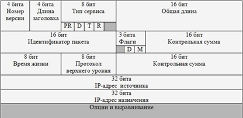
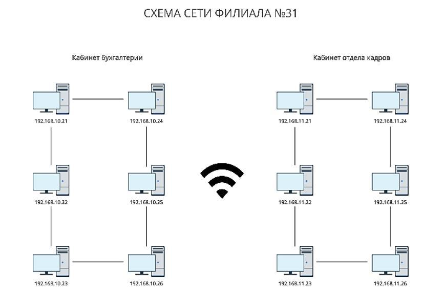
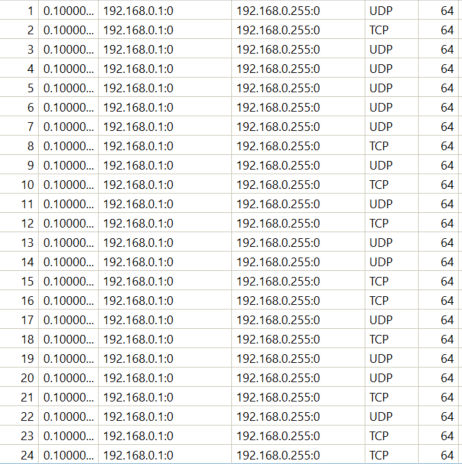

## Модуль 4. Раздел 3. Практика решения задач прошлых лет.

---

### Источники задач

- [Пробный тест олимпиады](../materials/pure-variants/trial-tests/ikb-practice-test.md#3-скрытый-канал-в-поле-id-ipv4)
- [Варианты прошлых лет на официальном сайте](https://ikb.mtuci.ru/materials/)

---

Попробуйте решить задачи самостоятельно. Для решения на Python достаточно стандартной библиотеки. Перед разбором можно прочитать подсказку к задаче.

Рекомендуемое время на решение:

- **Задача №1** — до 10 минут.
- **Задача №2** — до 20 минут.
- **Задача №3** — до 15 минут.

---

## №1. «Скрытый канал в поле ID IPv4». Пробный тест, задача №3 (уровень: **Легко**)

### Условие

> В учебной задаче под скрытое сообщение отведено 16-битное поле ID каждого пакета. Размер пакета составляет 1500 байт, из них 54 байта занимает заголовок.
>
> Сообщение — «Встреча завтра вечером в 18:00 у памятника Пушкину.». Сколько байт приходится на полезную нагрузку всех пакетов, необходимых для передачи сообщения?
>
> 

> [!Подсказка]
> Переведите размер поля ID из битов в байты и округлите необходимое число пакетов вверх.

> [!Решение]
> Поле ID занимает `16 / 8 = 2` байта. В разборе пробного теста используется однобайтовая кодировка, поэтому 51 символ сообщения занимает 51 байт. На 25 пакетов пришлось бы только 50 байт скрытого сообщения, значит нужен ещё один пакет. Всего их 26.
>
> По условию полезная нагрузка одного пакета занимает `1500 − 54 = 1446` байт. Суммарно получается `26 × 1446 = 37 596` байт.

> [!Ответ]
> `37596` байт.

---

## №2. «Ping». Заключительный этап. 8–10 классы. 2025–2026 год. Задача №4, вариант 1. (Уровень: **Средне**)

### Условие

> Аналитики компании «AC-Крипто» получили фрагмент сетевого трафика. Известно, что в нём передали место встречи. Определите это место и IP-адрес отправителя скрытого сообщения.
>
> 
>
> К задаче прилагаются [журнал трафика logs_v1.txt](../materials/pure-variants/2025-2026/zakl-10-class-materials/4/logs_v1.txt) и [таблица ASCII](../materials/pure-variants/2025-2026/zakl-10-class-materials/ASCII-table.pdf).

[Оригинал задачи, с. 13–14](../materials/pure-variants/2025-2026/zakl-10-class-materials/zakl-10-class.pdf#page=13)

> [!Подсказка]
> Посмотрите на значения `icmp_seq`. Какие из них совпадают с кодами печатных символов ASCII? Сравните адреса в соответствующих строках.

> [!Решение]
> В поле `icmp_seq` записан порядковый номер запроса `ping`. В этом журнале встречаются разрозненные значения вроде `213`, `157` и `25`. Проверим, складываются ли числа в сообщение, если читать их как десятичные коды ASCII.
>
> Оставим значения от `32` до `126` включительно. В этот диапазон входят пробел, буквы, цифры и знаки препинания. Сгруппируем сохранённые значения по паре IP-адресов источника и назначения. Внутри каждой группы прочитаем символы в порядке строк журнала.
>
> Сохраните скрипт рядом с `logs_v1.txt` и запустите из этой папки.
>
> ```python
> import re
> from collections import defaultdict
> from pathlib import Path
>
> log_lines = Path("logs_v1.txt").read_text(encoding="utf-8").splitlines()
> codes_by_pair = defaultdict(list)
>
> for line in log_lines[1:]:  # Пропускаем строку с названиями столбцов.
>     sequence = re.search(r"\bicmp_seq=(\d+)\b", line)
>     if sequence is None:
>         continue
>
>     _, source, destination, protocol, _ = line.split(maxsplit=4)
>     code = int(sequence.group(1))
>     if protocol == "ICMP" and 32 <= code <= 126:
>         codes_by_pair[source, destination].append(code)
>
> for (source, destination), codes in codes_by_pair.items():
>     print(source, "→", destination, bytes(codes).decode("ascii"))
> ```
>
> Все восемь подходящих записей идут от `192.168.10.21` к `192.168.10.26`. Коды `98, 97, 114, 32, 76, 73, 70, 69` образуют строку `bar LIFE`.

> [!Ответ]
> Место встречи — `bar LIFE`. IP-адрес отправителя — `192.168.10.21`, адрес назначения — `192.168.10.26`.

---

## №3. Сетевая стеганография. Отборочный этап 2023–2024 года, 8–10 классы, задача 2, вариант 1 (уровень: **Легко**)

### Условие

> Аналитик перехватил фрагмент сетевого трафика со скрытым сообщением. На рисунке показаны 24 пакета. Восстановите переданное слово и запишите его без пробелов.
>
> 
>
> [Таблица ASCII](../materials/module-1/section-2/ASCII_table.pdf) · [Условие в сборнике, с. 3](../materials/pure-variants/2023-2024/otbor-10-class.pdf#page=3)

> [!Подсказка]
> В столбце протоколов встречаются только TCP и UDP. Как превратить список из 24 протоколов в три байта?

> [!Решение]
> Слово закодировано последовательностью протоколов. Сопоставим каждому протоколу одну двоичную цифру. Для UDP берём `0`, для TCP — `1`. Читаем все строки сверху вниз по их номерам.
>
> Разбиваем 24 бита на группы по восемь и переводим каждый байт в символ ASCII.
>
> | Строки | Двоичный код | Десятичный код | Символ |
> | --- | --- | ---: | --- |
> | 1–8 | `01000001` | 65 | A |
> | 9–16 | `01010011` | 83 | S |
> | 17–24 | `01001011` | 75 | K |
>
> Возможны два соответствия. Если поменять `0` и `1` местами, уже первый байт станет `10111110` (190), а такого кода в ASCII нет.

> [!Ответ]
> `ASK`
