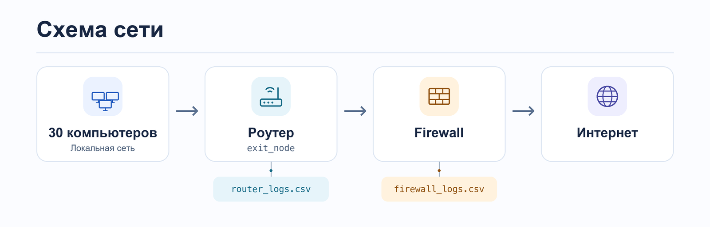

## Модуль 4. Раздел 4. Решение авторских задач.

---

> В этом разделе собраны **авторские задачи** по цифровой форензике и сетевой стеганографии. Для решения на Python достаточно стандартной библиотеки.

Рекомендуемое время на решение

- **Задача №1** — до 15 минут.
- **Задача №2** — до 20 минут.

---

## №1. Авторская задача. Обмен флагами. (Уровень: **Легко**)

### Условие

> Тайный информатор, представитель оптоволокна, сообщил, что двое участников нашей AD CTF обмениваются флагами. Вам поручили вычислить их по сетевой активности.
>
> В ответе укажите ID отправителя, ID получателя и флаг.
>
> К задаче прилагается [журнал запросов traffic.csv](../materials/module-4/section-4/task-1/traffic.csv). В поле `data` каждой записи находится одно число.

> [!Подсказка]
> Прочитайте отдельно запросы для каждой пары «отправитель → получатель». На что похожи числа из `data`?

> [!Решение]
> Запросы разных участников перемежаются в общем журнале. Отсортируем записи по `id` и сгруппируем их по паре `(sender_user_id, reciver_user_id)`. Для каждой пары преобразуем числа из `data` в символы через `chr()` и прочитаем получившуюся строку.
>
> Сохраните скрипт рядом с `traffic.csv` и запустите его из этой папки.
>
> ```python
> import csv
> from collections import defaultdict
>
> with open("traffic.csv", encoding="utf-8", newline="") as file:
>     records = sorted(csv.DictReader(file), key=lambda row: int(row["id"]))
>
> streams = defaultdict(list)
>
> for row in records:
>     pair = (row["sender_user_id"], row["reciver_user_id"])
>     streams[pair].append(chr(int(row["data"])))
>
> for (sender, receiver), chars in streams.items():
>     message = "".join(c if 32 <= ord(c) <= 126 else "." for c in chars)
>     print(f"{sender} -> {receiver}: {message}")
> ```
>
> Среди 90 направленных потоков видна строка `104 -> 102: ctfinf{diskval-ctf-by-menad}`. При выводе непечатные коды отображаются точками.

> [!Ответ]
> Отправитель — `104`, получатель — `102`. Флаг — `ctfinf{diskval-ctf-by-menad}`.

---

## №2. Авторская задача. Заражённый компьютер. (Уровень: **Средне**)

### Условие

> В компьютерном классе школы №1576 заразили один из 30 компьютеров. Найдите его, пока флаги для ВсОШ не утекли другим сборным.
>
> Роутер `exit_node` записывает входящие запросы от компьютеров. Firewall видит запросы на выходе из сети и помечает обращения к серверу управления вредоносной программой статусом `C2`.
>
> На выходе размер передачи может увеличиться на **0–3072 байта**. Протокол запроса остаётся тем же (`TCP` или `UDP`). Идентификаторы записей в двух журналах независимы.
>
> Сопоставьте записи по размеру передачи и протоколу. В ответе укажите `computer_id` заражённого компьютера.
>
> 
>
> К задаче прилагаются [журнал роутера router_logs.csv](../materials/module-4/section-4/task-2/router_logs.csv) и [журнал Firewall firewall_logs.csv](../materials/module-4/section-4/task-2/firewall_logs.csv).

> [!Подсказка]
> Соберите множество подходящих компьютеров для каждой отметки `C2`. Какой компьютер встречается во всех множествах?

> [!Решение]
> Запрос подходит, если протокол совпадает, а разница между размером на выходе и размером на входе составляет от 0 до 3072 байт включительно. Например, для отметки `C2` с протоколом `TCP` и размером 35 840 байт ищем входящие запросы `TCP` размером от 32 768 до 35 840 байт.
>
> | Протокол | Размер на выходе, байт | Кандидаты |
> | --- | ---: | --- |
> | TCP | 35 840 | 3, 7, 11, 17, 23, 28 |
> | UDP | 46 080 | 2, 7, 13, 17, 23, 30 |
> | TCP | 57 344 | 4, 7, 10, 17, 19, 27 |
> | UDP | 64 512 | 4, 10, 13, 17, 23, 28 |
>
> После первых трёх отметок остаются компьютеры `7` и `17`. Четвёртой отметке из них соответствует только `17`.
>
> Сохраните скрипт рядом с обоими CSV и запустите из этой папки.
>
> ```python
> import csv
>
> with open("router_logs.csv", encoding="utf-8", newline="") as file:
>     router_requests = [
>         (int(row["computer_id"]), row["protocol"], int(row["bytes_transferred"]))
>         for row in csv.DictReader(file)
>     ]
>
> candidates = []
>
> with open("firewall_logs.csv", encoding="utf-8", newline="") as file:
>     for row in csv.DictReader(file):
>         if row["status"] != "C2":
>             continue
>
>         outgoing = int(row["bytes_transferred"])
>         matching_computers = {
>             computer_id
>             for computer_id, protocol, incoming in router_requests
>             if protocol == row["protocol"] and 0 <= outgoing - incoming <= 3072
>         }
>         candidates.append(matching_computers)
>
> infected = set.intersection(*candidates)
> print(*sorted(infected))
> ```

> [!Ответ]
> `17`.
