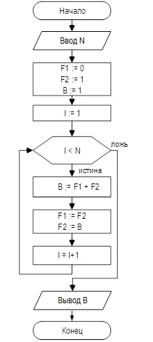
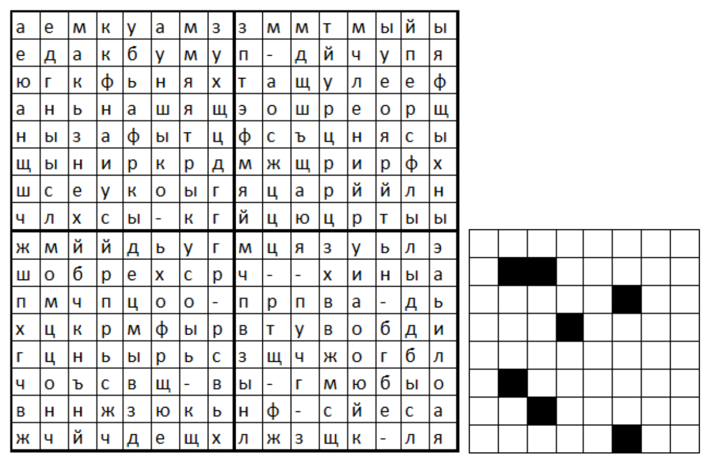

## Модуль 5. Раздел 3. Практика решения задач прошлых лет

---

### Источники задач

- [Архив задач на официальном сайте олимпиады](https://ikb.mtuci.ru/archive_task/)
- [Варианты прошлых лет](https://ikb.mtuci.ru/materials/)
- [Пробный тест олимпиады](../materials/pure-variants/trial-tests/ikb-practice-test.md)

Рекомендуемое время на решение — до 5 минут для первой задачи и до 15 минут для второй.

---

## №1. Крипто-блок-схема. Пробный тест, задача №4 (уровень **Легко**)

### Условие

> На рисунке представлена блок-схема алгоритма. Что выведет программа, если на вход подать `11`?
>
> 

> [!Подсказка]
> Проследите, как меняются `F1` и `F2` после каждого прохода, и посчитайте, сколько раз выполнится цикл `I < N`.

> [!Решение]
> Счётчик `I` начинается с 1, поэтому при `N = 11` тело цикла выполняется десять раз. На каждом шаге `B` получает сумму двух предыдущих чисел, а `F1` и `F2` сдвигаются на одну позицию.
>
> Вместе с начальным значением получаем последовательность значений `B` — `1, 1, 2, 3, 5, 8, 13, 21, 34, 55, 89`. При `I = 11` цикл завершается, программа выводит последнее значение.

> [!Ответ]
> `89`

---

## №2. Решётка Кардано. Отборочный этап 2024–2025 года, 11 класс, задача №5, вариант 1 (уровень **Средне**)

### Условие

> Сотрудник ИТ-отдела зашифровал решёткой Кардано сообщение о времени встречи, на которой планировал передать данные. Отдел информационной безопасности получил зашифрованную таблицу и решётку.
>
> Определите время встречи. В ответе укажите полную строку расшифрованного сообщения без лишних пробелов.
>
> 
>
> [Оригинал задачи](../materials/pure-variants/2024-2025/otbor-11-class.pdf#page=8)

> [!Подсказка]
> Чёрные клетки обозначают окна. Наложите решётку на левый верхний квадрат таблицы и прочитайте буквы в окнах по строкам.

> [!Решение]
> Оставим решётку неподвижной. После каждого чтения поворачиваем всю таблицу на 90° против часовой стрелки и снова накладываем решётку на её левый верхний угол. В каждом положении читаем строки сверху вниз, а окна в строке — слева направо.
>
> | Суммарный поворот таблицы | Символы в окнах |
> | ---: | :--- |
> | 0° | `данные-` |
> | 90° | `передам` |
> | 180° | `сегодня` |
> | 270° | `ночью--` |
>
> Удаляем дефисы из каждого блока и соединяем четыре слова пробелами.

> [!Ответ]
> `ДАННЫЕ ПЕРЕДАМ СЕГОДНЯ НОЧЬЮ`
